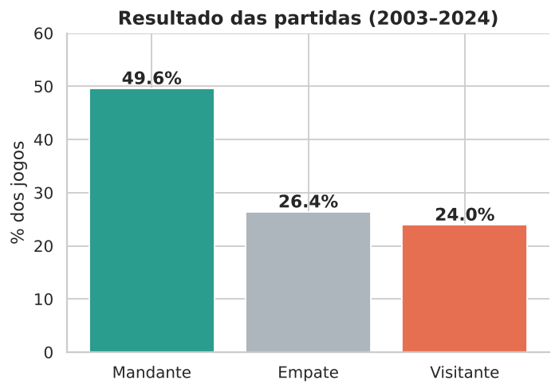
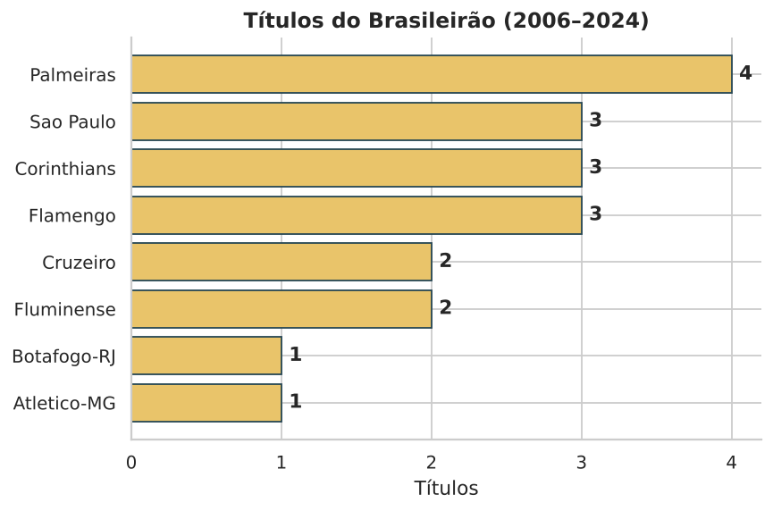
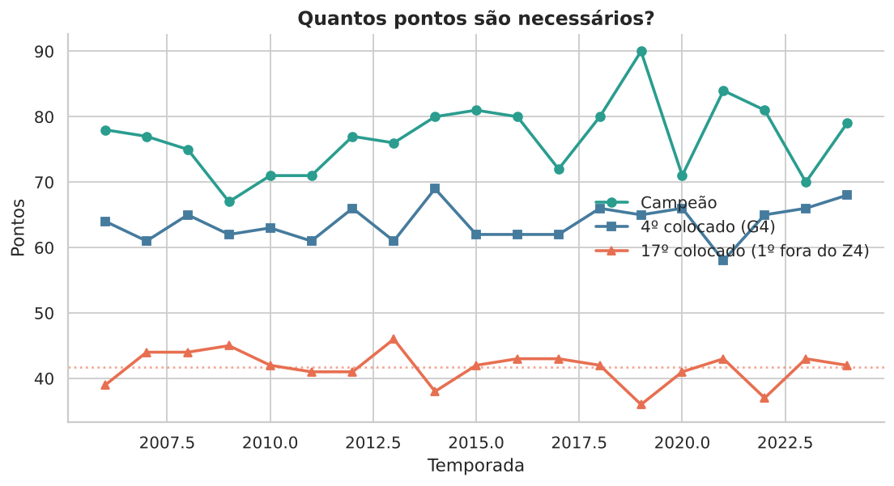
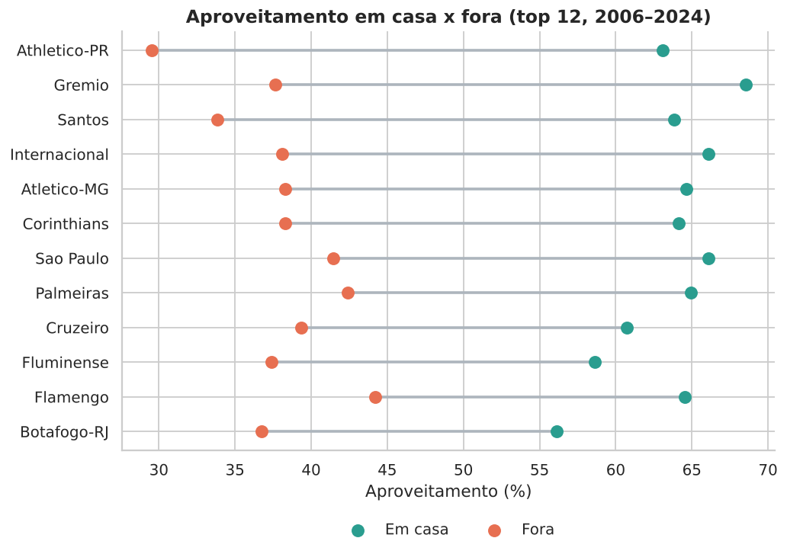
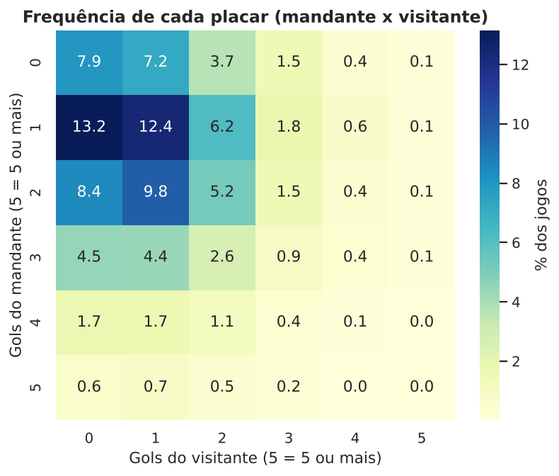

# ⚽ Análise de Dados do Campeonato Brasileiro (2003–2024)

Projeto de **ciência de dados com Python** que explora mais de **8.700 partidas** do Brasileirão Série A para entender fator casa, gols, campeões, desempenho dos clubes e até que ponto é possível **prever o resultado de um jogo**.



## 🎯 Perguntas respondidas

1. O fator casa existe? Mudou ao longo dos anos?
2. Quantos gols saem por jogo e quais placares são mais comuns?
3. Quem são os maiores campeões da era dos pontos corridos (2006–2024)?
4. Quantos pontos são necessários para ser campeão, ir ao G4 ou escapar do rebaixamento?
5. Quais clubes têm o melhor aproveitamento, em casa e fora?
6. Um modelo de machine learning consegue prever o resultado de uma partida?

## 🔎 Principais resultados

- **Fator casa:** o mandante vence **49,6%** dos jogos, o visitante **24,0%** e **26,4%** terminam empatados. A taxa de vitória do mandante caiu de ~**51%** (2003–2016) para ~**47%** (2017–2024).
- **Gols:** média de **2,56 gols por jogo**. O placar mais comum é 1 x 0 para o mandante (~13% dos jogos), seguido de 1 x 1 e 2 x 1.
- **Campeões (2006–2024):** **Palmeiras** lidera com 4 títulos; São Paulo, Corinthians e Flamengo têm 3 cada.
- **Pontos necessários (média 2006–2024):** ~**77** para o título, ~**64** para o 4º lugar e ~**42** para o 17º colocado (primeiro fora do rebaixamento).
- **Casa vs. fora:** os 12 clubes com melhor aproveitamento rendem mais em casa. A diferença vai de ~19 p.p. (Botafogo) a ~34 p.p. (Athletico-PR).
- **Modelo preditivo:** a Random Forest atingiu **48,3%** de acurácia no teste (2022–2024), contra **46,1%** do baseline "sempre vence o mandante". O ganho é pequeno, e o modelo prevê "Mandante" na grande maioria dos jogos. Isso confirma o peso do acaso no futebol.

<p align="center">
  
  
</p>
<p align="center">
  
  
</p>

## 🧠 Metodologia

| Etapa | O que foi feito |
|-------|-----------------|
| **Limpeza** | Conversão de datas, tratamento da temporada 2020 (que terminou em fev/2021) e criação de `gols_total` e `resultado` |
| **Reestruturação** | Transformação para formato "longo" (1 linha por time por jogo) para calcular tabelas de classificação |
| **Análise exploratória** | Fator casa, gols, placares, campeões e pontuação necessária (visualizações com Matplotlib/Seaborn) |
| **Feature engineering** | Rating **Elo** calculado jogo a jogo + forma e saldo de gols nos últimos 5 jogos |
| **Modelagem** | Regressão Logística e Random Forest, comparados a um baseline |
| **Validação** | **Divisão temporal** (treino 2006–2021, teste 2022–2024) e features calculadas só com informação *anterior* ao jogo, evitando *data leakage* |

> As classificações e campeões consideram apenas **2006–2024**, quando o formato de 20 clubes em pontos corridos se consolidou. Em 2003–2005 o campeonato teve formatos diferentes.

## 📁 Estrutura do projeto

```
brasileirao-analise/
├── data/
│   └── campeonato-brasileiro-full.csv   # dados brutos
├── notebooks/
│   └── analise_brasileirao.ipynb        # análise completa e comentada
├── src/
│   └── data_processing.py               # funções reutilizáveis (limpeza e classificação)
├── images/                              # gráficos gerados pelo notebook
├── requirements.txt
└── README.md
```

## 🚀 Como executar

```bash
# 1. Clone o repositório
git clone https://github.com/cauanziggs/brasileirao-analise.git
cd brasileirao-analise

# 2. (Opcional) crie um ambiente virtual
python -m venv .venv
source .venv/bin/activate        # Windows: .venv\Scripts\activate

# 3. Instale as dependências
pip install -r requirements.txt

# 4. Abra o notebook
jupyter notebook notebooks/analise_brasileirao.ipynb
```

## 🛠️ Tecnologias

Python · Pandas · NumPy · Matplotlib · Seaborn · Scikit-learn · Jupyter

## ⚠️ Limitações

- O dataset não tem dados de público, cartões, escanteios ou escalações completas (formações e técnicos estão ausentes em mais da metade dos jogos), o que limita o modelo.
- A queda do fator casa é descrita, mas **suas causas não foram testadas** neste projeto.
- O modelo é um exercício de fluxo de ciência de dados, não uma ferramenta de apostas.

## 🔮 Próximos passos

- Incluir dados de público, cartões e escanteios.
- Prever número de gols com modelos de Poisson.
- Criar um dashboard interativo com Streamlit.
- Comparar com a Série B e outros campeonatos.

## 📚 Fonte dos dados

Dados públicos de partidas do Campeonato Brasileiro reunidos em [adaoduque/Brasileirao_Dataset](https://github.com/adaoduque/Brasileirao_Dataset). Confira a licença e os termos de uso do repositório original antes de redistribuir os dados.

## 👤 Autor

**Cauan alves** · [LinkedIn](linkedin.com/in/cauan-alves-36864a369) · [GitHub](hhttps://github.com/cauanziggs)
